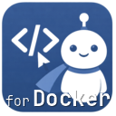
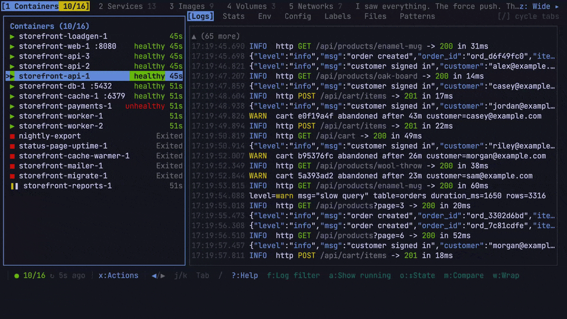
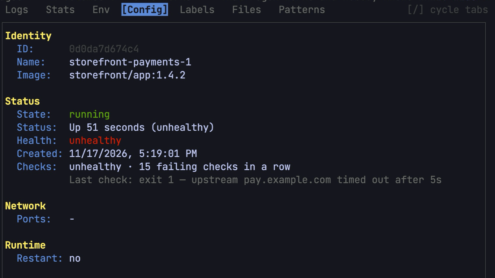
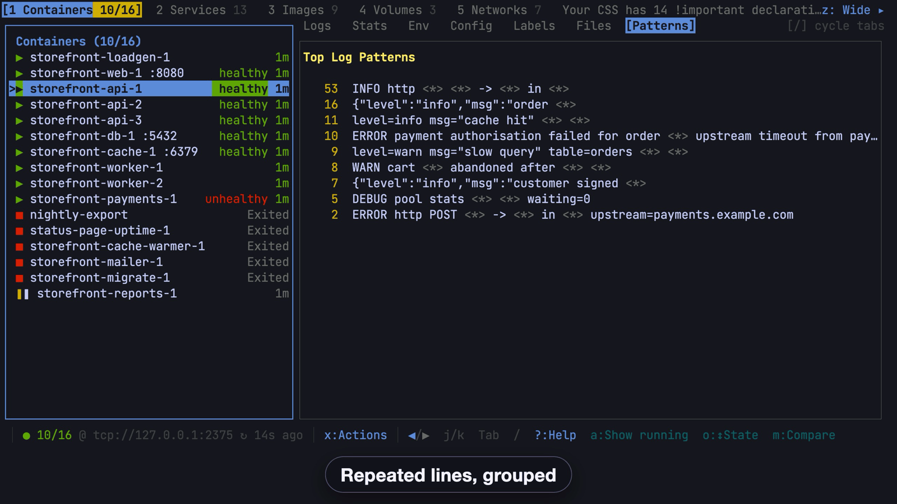
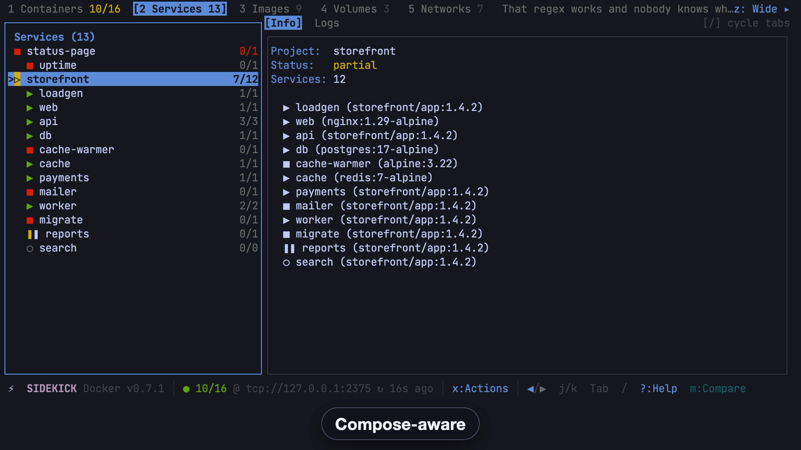
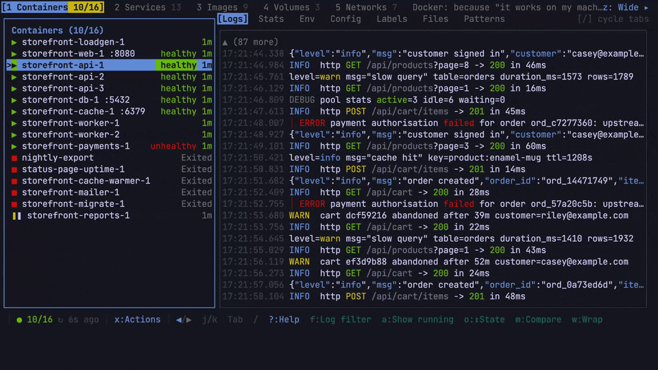
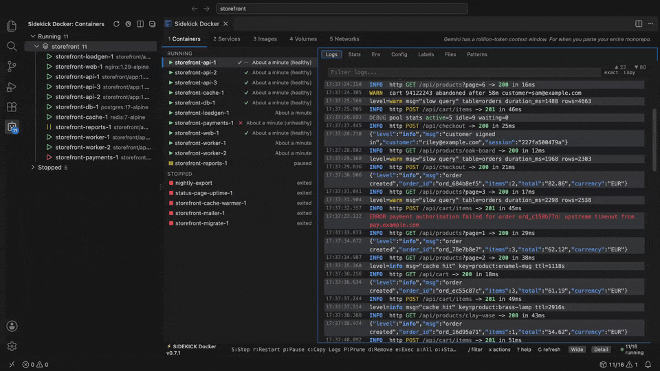

<p align="center">
  
</p>

<h1 align="center">Sidekick Docker</h1>

<p align="center">
  <b>A live Docker dashboard for your terminal and VS Code.</b><br>
  Containers, Compose services, logs, stats, images, volumes and networks in one keyboard-driven view.
</p>

<p align="center">
  <a href="https://www.npmjs.com/package/sidekick-docker"></a>
  <a href="https://www.npmjs.com/package/sidekick-docker"></a>
  <a href="https://open-vsx.org/extension/CesarAndresLopez/sidekick-docker-vscode"></a>
  <a href="https://open-vsx.org/extension/CesarAndresLopez/sidekick-docker-vscode"></a>
  <a href="https://github.com/cesarandreslopez/sidekick-docker/actions/workflows/ci.yml"></a>
  <a href="LICENSE"></a>
  <a href="https://deepwiki.com/cesarandreslopez/sidekick-docker"></a>
</p>

<p align="center">
  
</p>

Working with Docker from a terminal usually means four windows, `docker ps`, `docker logs -f`, `docker stats` and `docker compose ps`, and switching between them to piece together what is going on. Sidekick Docker puts all of it on one screen that stays current from Docker's own event stream, and lets you act on what you see with one key: restart a service, open a shell, prune what has stopped.

- **Logs you can read**: highlighting for HTTP lines, JSON and log levels, a filter that works as you type, severity counts, repeated lines grouped into patterns, and two streams side by side.
- **Why it broke, without `docker inspect`**: a failing health check's last probe output, exit codes, OOM kills and restart counts.
- **Compose-aware**: projects and replicas from container labels, services declared but not yet created, and up, restart and down.
- **Safe by default**: every remove and prune asks first and names its target, and a prune reports what it reclaimed.
- **Wherever Docker runs**: a local socket, `tcp://` or `DOCKER_HOST=ssh://`, in a terminal on a server or in VS Code, including Remote-SSH, WSL and Dev Containers.

## Install

**Terminal** (Node.js 22.12+, and the `docker` CLI on your `PATH` for Compose and exec):

```bash
npm install -g sidekick-docker
sidekick-docker
```

**VSCodium and other Open VSX editors**: install **Sidekick Docker** from [Open VSX](https://open-vsx.org/extension/CesarAndresLopez/sidekick-docker-vscode).

**VS Code**: download `sidekick-docker-vscode-<version>.vsix` from the [latest release](https://github.com/cesarandreslopez/sidekick-docker/releases/latest), then run `code --install-extension sidekick-docker-vscode-<version>.vsix` (or **Extensions: Install from VSIX…**).

In the editor, run **Sidekick Docker: Open Dashboard** (`Ctrl+Alt+D`) or open the Sidekick Docker icon in the activity bar.

Sidekick Docker uses `DOCKER_HOST` when it is set and the default socket otherwise. It does not read `docker context`, so with Colima, OrbStack or rootless Docker pass `--socket` or set `DOCKER_HOST` (in VS Code, the `sidekick-docker.socketPath` setting).

## What you get

| Why it's unhealthy | Repeated lines, grouped | Compose at a glance |
| :---: | :---: | :---: |
|  |  |  |
| The **Config** tab shows what only `docker inspect` knows: the health check's failing streak and last output, the exit code, OOM kills, the restart policy and count, and mounts. | The **Patterns** tab groups a container's log lines into templates with `<*>` wildcards and counts, so a flood of one message stands out. Logs also show **E/W/I/D** severity counts. | The **Services** panel shows each Compose project with running/total replicas, including services in the compose file that have no container yet, and runs up, restart, stop and down. |

## In the terminal

<p align="center">
  
</p>

Everything is a key away, and the status bar shows the keys that apply where you are:

| Keys | What they do |
| --- | --- |
| `1`–`5` | Containers, Services, Images, Volumes, Networks |
| `j` `k`, `[` `]` | Move through the list; cycle detail tabs (Logs, Stats, Env, Config, Labels, Files, Patterns) |
| `/`, `f` | Filter the list; filter the logs (exact or fuzzy) |
| `m` | Compare the selected item's logs with another's |
| `x` | The actions menu, showing only what applies, or press an action's key directly: `r` restart, `S` stop, `e` exec, `b` open in browser, `d` remove, `P` prune |
| `z`, `w`, `M` | Layout (Normal, Wide, Expanded), wrap long lines, mouse capture |
| `Ctrl+R`, `?`, `q` | Refresh, help, quit |

The mouse works too: click to select, scroll to navigate, right-click for the actions menu. From the npm package, `e` hands the terminal to `docker exec -it` and brings you back to the same view when you exit the shell; builds that can load `node-pty` run the shell inside the dashboard instead. See [all keybindings](https://cesarandreslopez.github.io/sidekick-docker/features/keybindings/).

## In VS Code

<p align="center">
  
</p>

The extension puts the same dashboard in an editor panel, with the same keys bar a few (`F5` refreshes, and there is no `M` or `q`). Beside it:

- a **Containers** tree in the activity bar, grouped into Running and Stopped with Compose projects as sub-groups, and **Compose Up / Restart / Down** on project groups;
- Compose output streamed into a **Sidekick Docker** output channel, with cancellable progress;
- **Exec** and **Show Logs** in integrated terminals;
- a status-bar count of running and unhealthy containers, and automatic reconnects when Docker comes back.

Settings and commands are in the [extension README](sidekick-docker-vscode/README.md), and the dashboard's keys in the [docs](https://cesarandreslopez.github.io/sidekick-docker/features/vscode/#dashboard-keys).

## For scripts

The same binary has non-interactive commands for scripts and pipes:

```bash
sidekick-docker ps -a --format json | jq -r '.[] | select(.state == "exited") | [.name, .status] | @tsv'
sidekick-docker stats --format json
sidekick-docker df                                  # images, containers, volumes and build cache
sidekick-docker logs web-1 --no-follow --tail 50
sidekick-docker inspect web-1 | jq .State.Health
```

`ps`, `images`, `volumes`, `networks` and `stats` take `--format json` and `-q`; `df` takes `--format json`; `inspect` always prints JSON. `--no-color` and `NO_COLOR` turn colour off everywhere. See the [CLI commands](https://cesarandreslopez.github.io/sidekick-docker/features/cli-commands/).

## Documentation

The [docs site](https://cesarandreslopez.github.io/sidekick-docker/) covers:

- [Installation](https://cesarandreslopez.github.io/sidekick-docker/getting-started/installation/) and [quick start](https://cesarandreslopez.github.io/sidekick-docker/getting-started/quick-start/)
- [The terminal dashboard](https://cesarandreslopez.github.io/sidekick-docker/features/dashboard/) and [keybindings](https://cesarandreslopez.github.io/sidekick-docker/features/keybindings/)
- [The VS Code extension](https://cesarandreslopez.github.io/sidekick-docker/features/vscode/)
- [Docker endpoints, TLS and SSH](https://cesarandreslopez.github.io/sidekick-docker/configuration/docker-socket/)
- [Architecture](https://cesarandreslopez.github.io/sidekick-docker/architecture/overview/)

## Packages

| Package | Description |
|---------|-------------|
| [`sidekick-docker-cli`](sidekick-docker-cli/) | The terminal dashboard and CLI commands (Ink + React), published to npm as `sidekick-docker` |
| [`sidekick-docker-vscode`](sidekick-docker-vscode/) | The VS Code extension, published to Open VSX |
| [`sidekick-docker-shared`](sidekick-docker-shared/) | The Docker API layer, state store, Compose detection and UI policy both share |

## Build from Source

```bash
git clone https://github.com/cesarandreslopez/sidekick-docker.git
cd sidekick-docker
bash scripts/build-all.sh
node ./sidekick-docker-cli/dist/sidekick-docker.mjs
```

Requires **Node.js >= 22.12** and **Docker** running. The demo GIFs are recorded from a script; see [`demo/`](demo/).

## See Also

**[Sidekick Agent Hub](https://github.com/cesarandreslopez/sidekick-agent-hub)**: see what your AI coding agents are doing, and what they cost. Live monitoring for Claude Code, Codex and OpenCode, as a [terminal dashboard on npm](https://www.npmjs.com/package/sidekick-agent-hub) and a VS Code extension on the [Marketplace](https://marketplace.visualstudio.com/items?itemName=CesarAndresLopez.sidekick-for-max) and [Open VSX](https://open-vsx.org/extension/cesarandreslopez/sidekick-for-max).

## Contributing

Contributions are welcome! See [CONTRIBUTING.md](CONTRIBUTING.md) for setup instructions and guidelines.

## License

[MIT](LICENSE)
