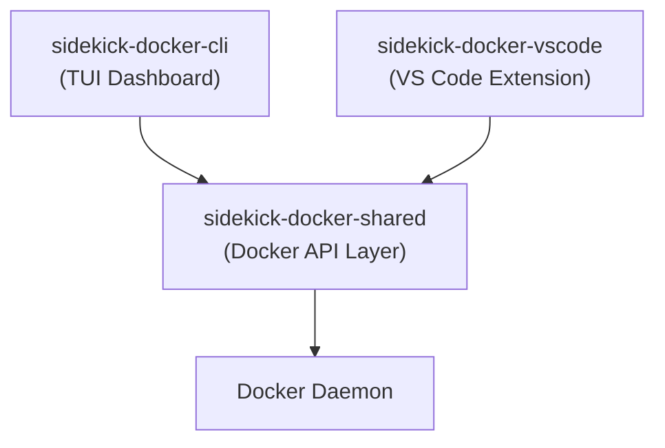
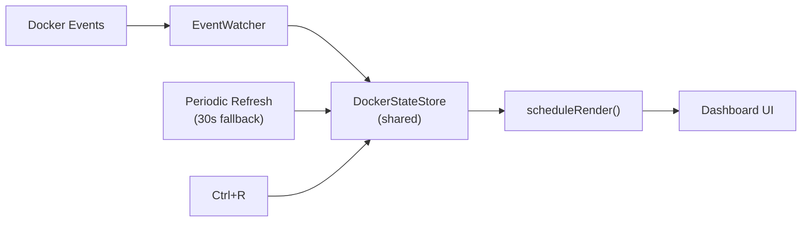

# Architecture Overview

Sidekick Docker is a monorepo with three packages that share a common Docker API layer.

## Package Structure



| Package | Build Tool | Output | Module Format |
|---------|-----------|--------|---------------|
| `sidekick-docker-shared` | tsc | `dist/` | CommonJS + declarations (Docker API, state store, stream policy, log analytics) |
| `sidekick-docker-cli` | esbuild | `dist/sidekick-docker.mjs` | ESM (single file) |
| `sidekick-docker-vscode` | esbuild | `out/extension.js` + `out/webview/dashboard.js` | CJS (extension) + IIFE (webview) |

## Data Flow



1. **Docker events** stream from the daemon via `EventWatcher`
2. Events go to the shared `DockerStateStore` (wrapped by the TUI's `DockerState`; the VS Code extension wraps the same store in `DockerService` and `ContainerWatcherService`). It patches its resource lists immediately where it can, ignores no-op events such as healthcheck `exec_*`, and otherwise requests a refresh debounced by 500ms
3. The store reports a change only when something actually changed; `scheduleRender()` then re-renders the dashboard (batched at 200ms), and finished log/stats streams of a container that just started resume
4. A 30-second periodic refresh provides a fallback in case events are missed; `Ctrl+R` refreshes immediately

A refresh pass makes a single container listing that also feeds volume and network usage (`DockerClient.listResources()`), reads compose config through a cache that runs `docker compose config` only when the compose files change, always commits (events that arrive mid-pass are replayed over its result), and is abandoned after 20 seconds, keeping the previous data. See [Streaming Architecture](streaming.md) for the stream side.

## Build System

The shared library must be built first — both CLI and VS Code packages depend on it via a local file path (`file:../sidekick-docker-shared`).

```bash
# Full build order
npm run build:shared   # tsc
npm run build:cli      # esbuild
npm run build:vscode   # esbuild
```

### esbuild Plugins (CLI)

The CLI build uses custom esbuild plugins to handle Node.js-specific modules:

- **SSH**: bundles `ssh2`; optional `cpu-features` and `sshcrypto.node` accelerators use the library’s JavaScript fallback in both consumers.
- **Stub**: `react-devtools-core` (optional development tooling)
- **Externals**: `node-pty` — an optional native module the npm package does not ship. When it cannot be loaded (the usual case for `npm install -g`), Exec hands the terminal to `docker exec -it` with the dashboard suspended; with it, the shell runs embedded in an overlay
- **Defines**: `__CLI_VERSION__` injected from `package.json`
- **Banner**: the `#!/usr/bin/env node` shebang (the output is chmodded 0755, so it runs directly) and a line mapping `NO_COLOR` to `FORCE_COLOR=0`, because chalk — which colours Ink's output — does not read `NO_COLOR`

### esbuild Output (VS Code)

The VS Code extension produces two bundles:

- `out/extension.js` — CJS, runs in the Node.js extension host
- `out/webview/dashboard.js` — IIFE, runs in the browser webview context
- **Defines**: `__VERSION__` injected from `package.json` (used for status bar display)

The webview source is modular — `dashboard.ts` orchestrates rendering, with keyboard handling (`keyboard.ts`), overlays (`overlays.ts`), and per-resource renderers (`panels/`) in separate modules — all bundled into the single IIFE file above.

## Dashboard Decomposition

The main `Dashboard` component delegates input handling to extracted modules:

- **`keyRegistry.ts`** — declarative registry of global keybindings; the single source of truth that drives dispatch, the help overlay, and status-bar hints
- **`useKeyboardHandler`** — keyboard input router with a fixed dispatch order: exec passthrough → Ctrl+C → active overlay handler → global bindings from the key registry → per-panel action shortcuts
- **`useMouseHandler`** — mouse click, scroll, and right-click handling, including clickable overlays
- **`Dashboard.tsx`** — state management (`useReducer`) and render orchestration
