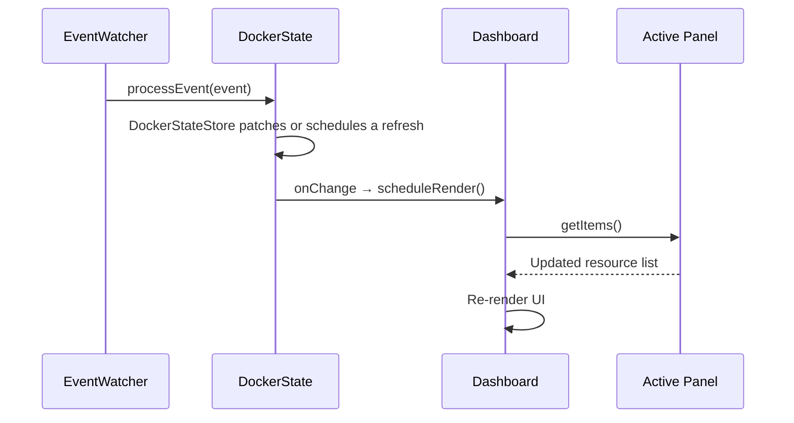

# Panel System

Every resource type in the dashboard is implemented as a panel that conforms to the `SidePanel` interface.

## SidePanel Interface

Each panel implements:

| Member | Purpose |
|--------|---------|
| `id`, `title`, `shortcutKey` | Panel identity, the title shown in the UI, and its number key (`1`–`5`) |
| `detailTabs[]` | Array of tab definitions (`label`, `render(item, metrics)`, optional `autoScrollBottom`) |
| `getItems(metrics)` | Returns the list of resources to display in the side list, from the current `DockerDashboardMetrics` |
| `getActions()` | Returns per-item actions for the actions menu and direct shortcuts (see below) |
| `getSearchableText(item)` | Optional per-item text used by the `/` filter |
| `onActivate()`, `onDeactivate()`, `dispose()` | Optional lifecycle hooks |

The interface is defined in `sidekick-docker-cli/src/dashboard/panels/types.ts`. Panels do not define keybindings themselves: global keys (including panel-contextual ones like filter, sort, and compare) live in the central registry at `sidekick-docker-cli/src/dashboard/ink/keyRegistry.ts`, while per-item action shortcuts come from `getActions()`.

### PanelAction

| Field | Purpose |
|-------|---------|
| `key`, `label` | Shortcut key and menu label |
| `handler(item)` | Runs the action; a returned (or resolved) string becomes the success-toast text, `null` suppresses the toast |
| `condition(item)` | Whether the action applies to this item |
| `actionType` | Lets the progress, success and failure toasts use the shared `actionText`/`actionFailedText` wording |
| `targetName(item)` | The name those toasts use when it is not the item's own (Up on a service acts on its project) |
| `runKey(item)` | What makes two runs "the same" for the in-flight guard when `targetName` repeats (a service `web` in two projects) |
| `confirm`, `confirmMessage`, `confirmSeverity` | Confirmation modal: a static message or a function of the item; severity `low` (yellow), `high` (red, default) or `batch` |
| `nothingToDo(item)` | Text when the action would do nothing (an empty prune): shown as an info toast and the confirm is skipped |

## Panel Implementations

All five live in `sidekick-docker-cli/src/dashboard/panels/`.

| Panel | Class | Resources |
|-------|-------|-----------|
| Containers | `ContainersPanel` | Docker containers |
| Services | `ServicesPanel` | Compose projects and services |
| Images | `ImagesPanel` | Local images |
| Volumes | `VolumesPanel` | Named volumes |
| Networks | `NetworksPanel` | Docker networks |

## VS Code PanelDefinition

The webview mirrors this with its own `PanelDefinition` in `sidekick-docker-vscode/src/webview/panels/types.ts` — parallel, not shared. It has the same `id`, `title`, `shortcutKey` and `detailTabs` (whose `render(item, state)` returns an HTML string), plus `getItems(snapshot)`, `getActions(item, snapshot)` and a **required** `getSearchableText(item, snapshot)`. Its `ActionDefinition` carries no handler — the webview posts the action to the extension host — and takes a required `actionType`, a static `nothingToDo` string and `condition(item, snapshot)`.

## State Management

The main `Dashboard` component uses `useReducer` for UI state (selected panel, selected item, focus area, filter text, modal state). Input handling is delegated to `useKeyboardHandler` and `useMouseHandler` hooks, with global keybindings defined in `keyRegistry.ts`.

Domain state (the actual Docker resources) lives in the `DockerState` class, which:

1. Delegates the resource lists (containers, images, volumes, networks, compose projects), refreshes and Docker event handling to the shared `DockerStateStore` — the same store the VS Code extension uses
2. Adds the TUI-only buffers: log rings, lazily fetched detail caches (inspect details, filesystem changes, image layers) and the stats collector
3. Passes on every store change — after an event that changed something, and after every refresh pass — through a change callback that resumes finished streams and calls `scheduleRender()`

Panels gate their actions with `condition` and word confirmations through shared helpers (`canStart`, `canStop`, `pruneConfirmFor` plus `pruneNothingText` for prunes, `removeContainerConfirmMessage` and the other `remove*ConfirmMessage` functions) so the TUI and the VS Code webview offer the same actions with the same wording.

## Rendering Flow

