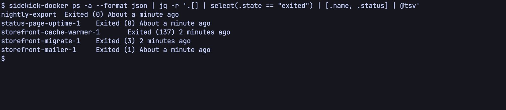
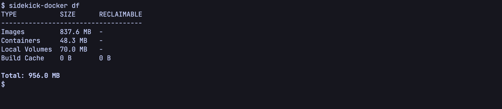

# CLI Commands

In addition to the interactive dashboard, Sidekick Docker provides eight non-interactive subcommands for scripting and quick lookups: `ps`, `logs`, `images`, `volumes`, `networks`, `stats`, `df` and `inspect`.

## `sidekick-docker` (no arguments)

Launches the interactive TUI dashboard. See [Dashboard Overview](dashboard.md).

## `sidekick-docker ps`

List containers in a table format.

```bash
# Running containers only (default)
sidekick-docker ps

# All containers (including stopped)
sidekick-docker ps --all

# Machine-readable JSON
sidekick-docker ps --format json

# Container IDs only (overrides --format)
sidekick-docker ps -q
```

| Flag | Description |
|------|-------------|
| `-a`, `--all` | Show all containers (default: running only) |
| `--format <table\|json>` | Output format (default: `table`) |
| `-q`, `--quiet` | Only print container IDs |

The JSON output pipes straight into `jq`, for example to list stopped containers with their exit status:

```bash
sidekick-docker ps -a --format json | jq -r '.[] | select(.state == "exited") | [.name, .status] | @tsv'
```



## `sidekick-docker logs`

Stream logs from a container.

```bash
# Follows when attached to a terminal; prints and exits when piped
sidekick-docker logs <container>

# Explicitly follow / don't follow
sidekick-docker logs <container> --follow
sidekick-docker logs <container> --no-follow

# Last 50 lines (default: 100)
sidekick-docker logs <container> --tail 50
```

| Flag | Description |
|------|-------------|
| `-f`, `--follow` | Follow log output (default when attached to a terminal) |
| `--no-follow` | Print logs and exit |
| `-n`, `--tail <lines>` | Number of lines to show from the end (default: 100) |

Each line starts with its timestamp in local time (`HH:MM:SS.mmm`). Lines the container wrote to stderr are printed in red, unless colour is off; all lines go to stdout.

## `sidekick-docker images`

Lists local images.

```bash
sidekick-docker images                 # table
sidekick-docker images --all           # include intermediate layers
sidekick-docker images -q              # IDs only, for piping
sidekick-docker images --format json
```

## `sidekick-docker volumes`

Lists all volumes, named and anonymous, including which containers currently mount each one.

```bash
sidekick-docker volumes
sidekick-docker volumes -q             # names only
sidekick-docker volumes --format json
```

## `sidekick-docker networks`

Lists networks with their subnet and attached-container count.

```bash
sidekick-docker networks
sidekick-docker networks -q            # IDs only
sidekick-docker networks --format json
```

## `sidekick-docker stats`

One-shot resource usage for every running container, like
`docker stats --no-stream`. It samples and exits rather than streaming, so it
composes in scripts and pipelines.

```bash
sidekick-docker stats
sidekick-docker stats -q               # container IDs only
sidekick-docker stats --format json
```

## `sidekick-docker df`

Aggregate disk usage, equivalent to `docker system df`. This is the only place
build cache is reported, and it is frequently the largest consumer.

```bash
sidekick-docker df
sidekick-docker df --format json
```



## `sidekick-docker inspect`

Prints the raw inspect payload for a container as JSON — everything the
dashboard's Config tab summarises (mounts, restart policy, health history, exit
status) plus what it leaves out, such as resource limits. Accepts a name, a full
ID, or an ID prefix.

```bash
sidekick-docker inspect web
sidekick-docker inspect web | jq .State.Health
```

Exits 1 when no container matches. An ID prefix that matches more than one container is refused, as `docker` does: the command lists the matching IDs and exits 1 instead of picking one.

## Global Options

| Flag | Description |
|------|-------------|
| `--socket <endpoint>` | Docker endpoint: socket path, `unix://` or `tcp://host[:port]` URL (see [Docker Socket](../configuration/docker-socket.md)). `ssh://` is not accepted here; set `DOCKER_HOST` instead |
| `--no-color` | Disable colored output (the `NO_COLOR` env var also disables it; `FORCE_COLOR` forces it on) |
| `--verbose` | Show full error details |
| `--shell <path>` | Shell for Exec in the dashboard (default: `$SIDEKICK_DOCKER_SHELL`, else `/bin/sh`) |
| `--no-mouse` | Start the dashboard with mouse capture off, so the terminal can select text (`M` toggles it) |
| `--version` | Show version |
| `--help` | Show help |

`NO_COLOR` and `--no-color` turn the interactive dashboard monochrome as well as the command output.

A mistyped subcommand fails with `error: unknown command` instead of starting the dashboard, and suggests the closest command when there is one: `sidekick-docker pss` prints `(Did you mean ps?)`.

## Environment Variables

| Variable | Description |
|----------|-------------|
| `DOCKER_HOST` | Docker endpoint used when `--socket` is not given (`unix://`, `tcp://`, `ssh://`). The only way to connect over `ssh://` |
| `SIDEKICK_DOCKER_SHELL` | Shell for dashboard Exec when `--shell` is not given (default `/bin/sh`) |
| `NO_COLOR` / `FORCE_COLOR` | Disable / force colored output |
| `DEBUG` | Any value prints the full error, with its stack trace, when a command or the dashboard fails unexpectedly (as `--verbose` does) |
