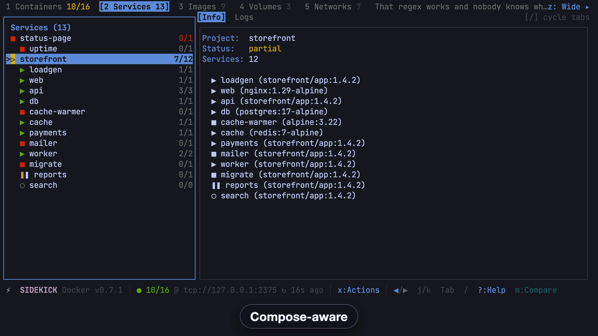

# Compose Services Panel

The Compose Services panel (press `2`) shows Docker Compose projects and their services.

## Project Detection

Sidekick Docker discovers Compose projects through two methods:

1. **Container labels** (primary) — reads `com.docker.compose.project` and `com.docker.compose.service` labels from running containers
2. **`docker compose config`** (secondary) — parses the compose file to discover services that may not have running containers. The TUI runs it in the directory you launched `sidekick-docker` from; VS Code runs it in the first workspace folder that has a compose file (only in a trusted workspace). The result is cached and `docker compose config` runs again only when a compose file changes (or after five minutes, to catch `include:`/`extends:` edits); `Ctrl+R` forces a re-read

These sources are merged to show a complete view: running containers alongside planned-but-not-running services.

## List Layout

Each project appears as a header row with its running/total service count. Under each project, individual services are listed with their current state and running/total replica counts. Scaled replicas share one service row; a running replica is preferred as its representative container. A project with only some replicas running has a partial status.

## Detail Tabs

### Info

For a project row: name, status and its service list. For a service row:
service name, project, image, state, replica counts, representative container ID and published ports across its replicas.

### Logs

Streamed logs for the selected project or service, including its replicas. For a side-by-side comparison, press `m` to pin the selected row, then select another project or service; press `m` again (on any row) or `Esc` to end it. Both panes update even when only the pinned source produces output.

## Actions

Press `x` on a project or service to open the context menu, or press an action's key directly:

| Key | Action | Description |
|-----|--------|-------------|
| `u` | Up project | `docker compose up -d` for the whole project, from a project row or any of its services |
| `D` | Down project | `docker compose down` for the whole project: removes its containers and networks (volumes are kept) — asks for confirmation naming the project |
| `r` | Restart | Restart the project or individual service |
| `S` | Stop | Stop the project or individual service |
| `c` | Copy Logs | Copy what the Logs tab shows (respecting the log filter) to the clipboard; see [Containers](containers.md#actions) for what the clipboard needs |

All compose operations run via the `docker compose` CLI through the `ComposeClient`.

Compose commands have deadlines, so a hung `docker compose` cannot block the dashboard forever: 30 seconds for log and status queries, 15 minutes for lifecycle actions (`up` may pull or build).

Lifecycle actions use the project's recorded working directory and all files from its `com.docker.compose.project.config_files` label, preserving override order. If a recorded file is missing, the action reports the missing path; restore the file before retrying. Projects discovered from workspace configuration use that workspace as their fallback directory.

## VS Code

The webview dashboard's Services panel offers the same actions. In the activity-bar **Containers** tree, right-click a Compose project group for **Compose Up**, **Compose Restart** and **Compose Down** (the last two for running projects; Down asks first). Compose is disabled in untrusted workspaces. See [VS Code Extension](vscode.md#containers-tree-view).
