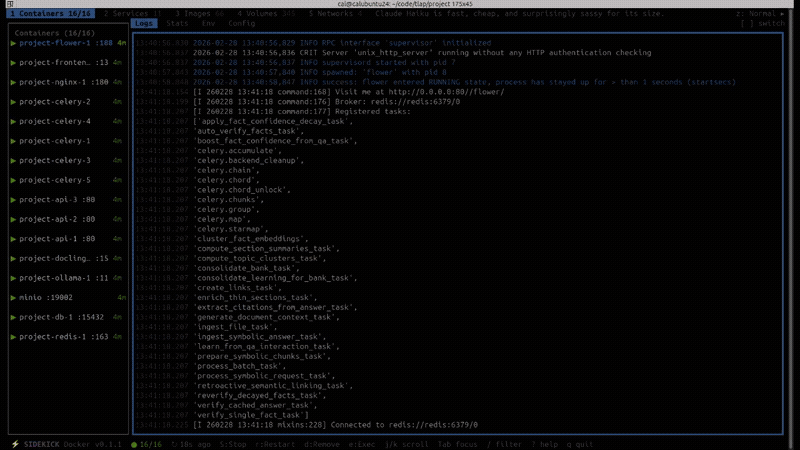

# Containers Panel

The Containers panel (press `1`) shows all Docker containers — running and stopped. Press `a` to toggle between showing all containers and only those with a live process (running, paused or restarting), as `docker ps` lists them.

## List Columns

Each container row displays:

- State icon (color-coded: green for running, red for stopped, yellow for other)
- Container name
- Port mappings (first exposed port)
- Health status badge (green=healthy, red=unhealthy, yellow=starting) when the container has a health check configured
- Uptime / exit status

## Detail Tabs

Select a container and press `Enter` or `Tab` to view its detail tabs:

### Logs

Live-streamed container logs with token-level syntax highlighting. Individual tokens — HTTP methods, status codes, URLs, IPs, timestamps, JSON keys, state keywords, and file paths — are each colored distinctly, giving you immediate visual parsing of log output. The log buffer holds the most recent 1000 lines.

Logs are selection-driven — streaming starts when you select a container and stops when you navigate away.

**Follow pause** — scrolling up in the Logs tab (keyboard or mouse wheel) pauses auto-follow so you can read scrollback; a `⏸ follow paused — G to resume` indicator appears in the detail tab bar. Press `G` or scroll back to the bottom to resume following.

**Severity badges** appear in the Logs tab header showing running counts of ERROR, WARN, INFO, and DEBUG lines, each colored by severity level.

**Log filter** — press `f` to open the filter overlay. Type a search query and press `Enter` to filter. Two modes are available (toggle with `Tab`):

- **Exact** — case-insensitive substring match
- **Fuzzy** — all words must appear in the line (AND logic), in any order

Matched text is highlighted and a match count is displayed. Press `Esc` to clear the filter.

**Log compare** — press `m` on a container to pin it as a compare target. When a compare target is pinned and you're viewing the Logs tab, both log streams are displayed side by side in left/right columns. Each column scrolls independently (`j`/`k` for primary, `Shift+J`/`Shift+K` for secondary). Press `m` again on the pinned item to unpin. Each panel remembers its compare target independently.

### Stats

Real-time CPU and memory usage rendered as sparkline charts. The stats collector maintains a 60-sample ring buffer, giving you a rolling view of resource usage.

**Network I/O** — cumulative RX/TX bytes with rate sparklines (bytes/sec) showing transfer activity over time.

**Block I/O** — cumulative read/write bytes with rate sparklines showing disk activity.

**PIDs** — current process count inside the container.

A **log severity sparkline** appears below the resource charts, showing the distribution of log severity over time. Each position is colored by the dominant severity in that time bucket (red for errors, yellow for warnings, blue for info).

Stats are also selection-driven to avoid unnecessary API overhead.

### Env

Environment variables set in the container, displayed as key-value pairs.

### Config

Container configuration details, grouped into sections:

- **Identity** — ID, name, image
- **Status** — state, status, health badge, creation time; for an exited or dead container, the **exit code** with `OOM killed` and any daemon error; for a container with a healthcheck, the **failing streak** and the last probe's exit code and output (usually the actual reason it is unhealthy)
- **Network** — published ports
- **Runtime** — restart policy (e.g. `on-failure (max 5)`) and how many times the container has restarted
- **Mounts** — each volume or bind mount as `source → destination (type, ro)`
- **Compose** — project and service, for Compose-managed containers

The Env and Config tabs come from a single `docker inspect` call, refreshed when the container starts, dies or changes health.

### Labels

Every label set on the container, sorted by key. Labels are how compose
projects, orchestrators and image build metadata identify themselves.

### Files

Shows all filesystem changes made inside the container compared to its base image. Each change is marked with a color-coded indicator:

- **A** (green) — file added
- **C** (yellow) — file changed
- **D** (red) — file deleted

Uses Docker's `container.changes()` API, which works on both running and stopped containers. Changes are fetched once on selection and cached.

### Patterns

Groups similar log lines into templates by replacing variable parts (IDs, IPs, timestamps) with `<*>` wildcards. Templates are ranked by frequency, helping you quickly identify the most common log patterns and spot anomalies.

For example, three lines like `User alice logged in from 192.168.1.1`, `User bob logged in from 10.0.0.1`, and `User charlie logged in from 172.16.0.1` would be grouped into: `User <*> logged in from <*>` (3 occurrences).

## Sorting

Press `o` to open the sort overlay. Sort containers by:

- **State** (default) — running first, then stopped
- **Name** — alphabetical
- **CPU %** — highest CPU usage first
- **Memory %** — highest memory usage first
- **Network I/O** — highest total network bytes first
- **Block I/O** — highest total disk bytes first
- **PIDs** — highest process count first

Use `j`/`k` to navigate, `Enter` to apply, `R` to reverse sort direction. You can also press `R` globally to toggle reverse sort. The sort menu and the toast describe the current order in words — "A→Z" / "Z→A" for names, "running first" / "stopped first" for state, "highest first" / "lowest first" for stats.

## Actions

Press `x` to open the context menu, or press an action's key directly. Only actions that apply to the container's current state are offered:

| Key | Action | Description |
|-----|--------|-------------|
| `s` | Start | Start an exited or created container (a paused one needs Unpause) |
| `S` | Stop | Stop a running, paused or restarting container |
| `r` | Restart | Restart a running container |
| `p` | Pause | Pause a running container |
| `u` | Unpause | Unpause a paused container |
| `d` | Remove | Remove a container (confirmation required; a running container is force-stopped first, and the prompt says so) |
| `e` | Exec | Open an interactive shell inside a running container |
| `b` | Open in Browser | Open a published TCP port in your browser |
| `c` | Copy Logs | Copy what the Logs tab shows (respecting the log filter) to the clipboard |
| `P` | Prune | Remove all stopped containers (confirmation names how many) |

### Open in Browser

`b` is offered for running containers with at least one published TCP port. It opens `http://<host>:<port>` (`https` for ports 443/8443) with the platform opener — `xdg-open`, `open`, or `rundll32` on Windows — without going through a shell. The host is `localhost` for a local socket, and the daemon's host when the endpoint is `tcp://` or `ssh://`. When several ports are published, the first is opened and the toast lists the others.

### Interactive Exec

The exec action opens a shell inside the container, `/bin/sh` by default. Choose another with `--shell <path>` or the `SIDEKICK_DOCKER_SHELL` environment variable (see [CLI Commands](cli-commands.md#global-options)). If the shell does not exist in the image — common for distroless and scratch images — a toast says so instead of the session silently closing.

How the session runs depends on whether the optional `node-pty` native module can be loaded:

- **Without `node-pty`** (the default for `npm install -g sidekick-docker`, which does not ship it) — the dashboard suspends its rendering and hands the terminal to `docker exec -it`. End the shell with `Ctrl+D` / `exit` to return to the same selection and view state.
- **With `node-pty`** (e.g. a source checkout, where it is a dev dependency) — the shell runs embedded in a dashboard overlay. Press `Ctrl+]` to detach back to the dashboard, or end the shell with `Ctrl+D` / `exit`.

  

