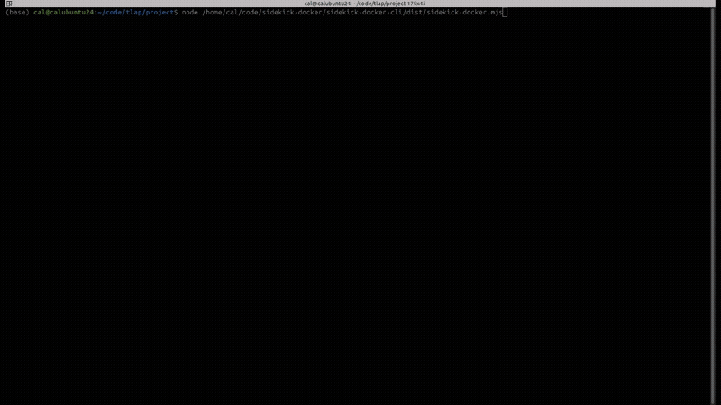

# Dashboard Overview

The Sidekick Docker dashboard is a five-panel TUI built with Ink and React. Each panel manages a different Docker resource type.

  

## Panel Layout

The dashboard uses a split layout:

- **Left pane** — resource list (containers, images, etc.)
- **Right pane** — detail tabs for the selected item (logs, stats, configuration)

Press **`z`** to cycle layout modes: **Normal** (28-col side panel) → **Wide** (side panel 40% of the terminal, 28–42 columns, for longer names) → **Expanded** (side panel hidden, detail pane only). In Expanded the detail tab strip names the selected item and focus stays on the details; press `z` again to get the list back.

List names that do not fit are shortened in the middle, so a replica's `-2` suffix or an image's `:tag` stays visible.

## Panels

| # | Panel | Each row shows |
|---|-------|----------------|
| 1 | **Containers** | State icon, name, first published port, health badge, uptime |
| 2 | **Services** | Compose projects (running/total services) with their services (running/total replicas) |
| 3 | **Images** | First tag (dangling images dimmed), size |
| 4 | **Volumes** | Name (in-use volumes highlighted), driver |
| 5 | **Networks** | Name (built-in networks highlighted), attached-container count |

Everything else — image, ports, mount paths, IPAM, layers — is in the detail tabs.

Switch panels with the number keys `1` through `5`.

## State Updates

The dashboard stays current through two mechanisms:

1. **Event-driven** — Docker daemon events (container start/stop, image pull, etc.) are streamed in real time via `EventWatcher`; bursts of events are coalesced into one refresh, and healthcheck noise is ignored
2. **Periodic refresh** — a full refresh runs every 30 seconds as a fallback

This means changes appear almost instantly without manual refreshing. To refresh immediately (for example after a resource failed to load), press **`Ctrl+R`**; it also re-reads the compose file.

## Actions

Press **`x`** on any selected item to open the context menu (titled with the item's name), or press an action's key (shown in the menu) directly. A key whose action does not apply to the item says so in a toast. Only actions that apply to the item's current state are offered — for example, Start is not offered for a paused container (Docker rejects it; use Unpause). Available actions vary by panel — see each panel's page for details.

Destructive actions (remove, prune) are color-coded red in the context menu and require a confirmation modal that names the exact target (e.g. `Remove container "web"?`, `Prune 3 dangling images?`); removing a running container warns that it will be stopped first. Long messages wrap to up to three lines rather than cutting off the target. `y` confirms; `Enter`, `Esc`, or `n` cancel — Enter is deliberately the safe default.

## Visual Indicators

- **Tab bar badges** — container count is color-coded: green when all running, yellow when partially running
- **Status bar** — shows the connection status and running/total count, any resources that failed to refresh, time since the last refresh (with a `(Ctrl+R)` hint once it is a minute old), `x:Actions` when the item has actions, focus, contextual hints, the active filter, `mouse off (M)` while mouse capture is off, and an always-visible `?:Help`; lower-priority segments drop out or shorten on narrow terminals
- **Selection** — focused items preserve their state icon color instead of overriding with a uniform highlight
- **Detail tab bar** — shows the tab label even for single-tab panels

## Mouse Support

Click to select items, switch panels and detail tabs, and press overlay buttons; right-click an item to open its actions menu. Over the list the scroll wheel moves the selection; over the details it scrolls them — scrolling up in a logs tab pauses follow (scroll back to the bottom or press `G` to resume). The wheel also scrolls the help overlay.

While the dashboard captures the mouse, most terminals cannot select text. Press **`M`** to turn mouse capture off (the status bar shows `mouse off (M)`) and select and copy text as usual, then `M` again to turn it back on. `--no-mouse` starts the dashboard with capture off.

## Minimum Terminal Size

The dashboard needs at least a 60×15 terminal. Smaller windows show a resize prompt (with the exact columns/rows needed) instead of a truncated UI.

## Toast Notifications

Action results appear as non-blocking toast notifications stacked in the top-right corner of the screen (just below the tab bar), with severity-specific icons and colored backgrounds. Up to three toasts are visible at once, so concurrent action results stack instead of overwriting each other. Long-running actions show a progress toast that resolves into a success toast — or an error toast carrying the actual Docker error message. Error toasts wrap to three lines and long messages stay up longer, so the reason is readable.

## Colour

The accent colour (`#5B8BD9`) is readable on both dark and light terminals. `NO_COLOR=1` or `--no-color` turns the whole dashboard monochrome.
