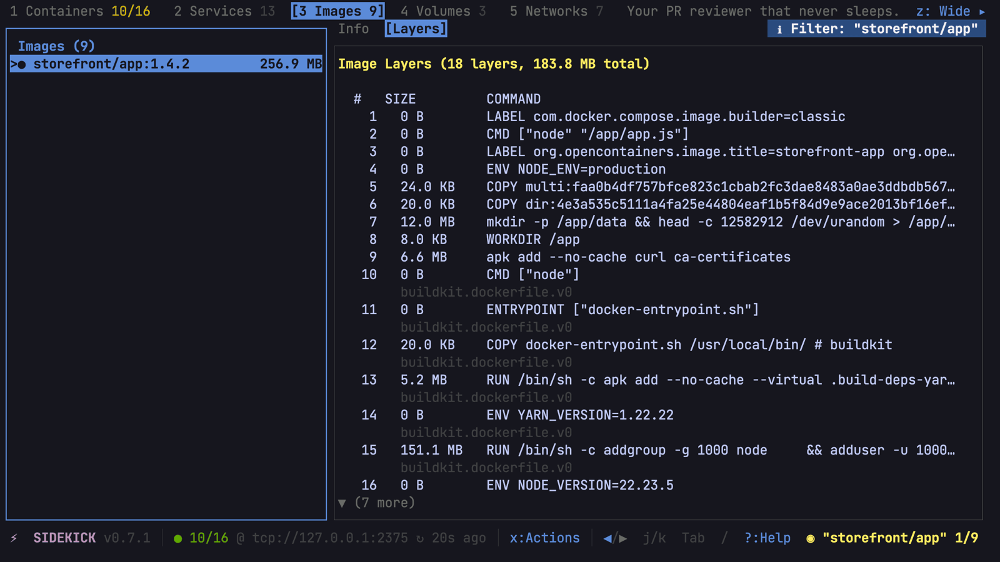

# Images Panel

The Images panel (press `3`) shows all local Docker images.

## List Columns

Each image row displays:

- Repository and tag
- Size (formatted)

The image ID and creation time are shown in the Info tab rather than the row.

## Detail Tabs

### Info

Full image details including ID, tags, size, creation date, and dangling status.

### Layers

Shows the full layer history of the image, in the same order as `docker history`: newest first. Each layer displays:

- **Layer number** — position in the list, so 1 is the newest layer (the last Dockerfile instruction) and the highest number is the base image's first layer
- **Size** — disk space consumed by the layer (0 B for metadata-only layers like ENV, LABEL)
- **Command** — the Dockerfile instruction that created the layer (e.g., `RUN apt-get install`, `COPY . /app`)
- **Comment** — the layer's comment, on its own line, when it has one (for example `buildkit.dockerfile.v0`)

The `/bin/sh -c #(nop)` prefix is automatically stripped for cleaner display. A summary at the bottom highlights the largest layer.

## Actions

Press `x` to open the context menu, or press `d` (Remove) / `P` (Prune) directly:

| Action | Description |
|--------|-------------|
| Remove | Remove the selected image (confirmation required). An image with several tags loses all of them, and the confirmation names them — for example `Remove image "app:1.2" and 2 other tags (app:latest, app:stable)?`. A multi-tag image that a container (running or stopped) still uses is refused, with the container named, before any tag is removed; for a single-tag image, the daemon's own refusal is shown |
| Prune | Remove all dangling (untagged) images (the confirmation names how many). When every image has a tag, it says there is nothing to prune instead of asking; if any untagged image exists it always asks, since the daemon may prune it |

Prune reports the total space reclaimed.
