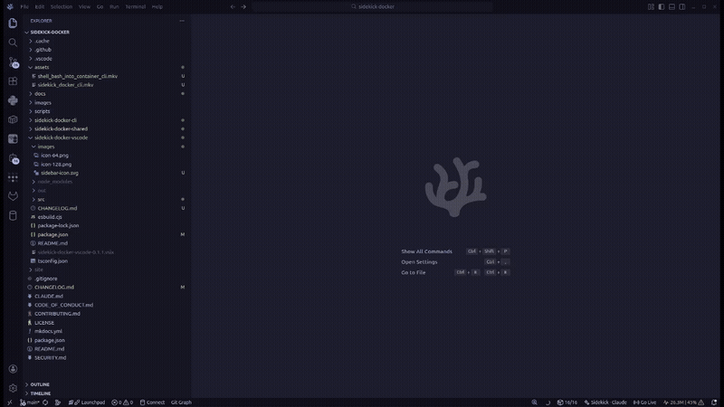

# VS Code Extension

The Sidekick Docker extension embeds the Docker dashboard as a webview panel inside your editor. Works with VS Code, VSCodium, and compatible editors.

<p align="center">
  
</p>

## Installation

Install from [Open VSX](https://open-vsx.org/extension/CesarAndresLopez/sidekick-docker-vscode) (recommended for VSCodium and compatible editors) or the [VS Code Marketplace](https://marketplace.visualstudio.com/items?itemName=CesarAndresLopez.sidekick-docker-vscode). You can also search for **Sidekick Docker** in the Extensions view.

## Opening the Dashboard

Open the command palette (`Ctrl+Shift+P` / `Cmd+Shift+P`) and run:

```
Sidekick Docker: Open Dashboard
```

or press `Ctrl+Alt+D` — `Ctrl`, not `Cmd`, on macOS too (macOS reserves `Cmd+Opt+D` for the Dock). The dashboard opens as a webview panel with the same layout as the terminal TUI. The dashboard panel survives window reloads.

## Commands

| Command | Description |
|---------|-------------|
| `Sidekick Docker: Open Dashboard` | Open the dashboard (`Ctrl+Alt+D`, all platforms) |
| `Sidekick Docker: Open Dashboard to the Side` | Open in a split editor column |
| `Sidekick Docker: Refresh Containers` | Refresh the tree view (`Ctrl+Alt+R` / `Cmd+Alt+R` when the Containers view is focused) |
| `Sidekick Docker: Start/Stop/Restart Container...` | Quick-pick a container to act on |
| `Sidekick Docker: Exec into Container...` | Quick-pick a running container and open a terminal inside it, using `sidekick-docker.exec.defaultShell` |
| `Sidekick Docker: Show Container Logs...` | Quick-pick a container and open a terminal running `docker logs -f --tail 200` for it |

The tree view adds **Open in Dashboard** for containers and **Compose Up / Compose Restart / Compose Down** for Compose project groups; those appear only in its context menu, not in the command palette.

## Containers Tree View

The activity-bar **Containers** view groups containers by state (and by Compose project). A container's context menu offers the actions that apply to its state — start, stop, restart, pause/unpause, remove (asks first; a running container is force-removed and the prompt says so), **Exec**, **Show Logs** and **Open in Dashboard** — and running-but-unhealthy containers are marked as such. Clicking a row (or pressing Enter on it) shows that container in the dashboard but keeps focus in the tree, so you can keep moving through the list; **Open in Dashboard** and `Ctrl+Alt+D` move focus to the dashboard.

Right-click a **Compose project group** for **Compose Up**, and for a project with live containers (running, paused or restarting) **Compose Restart** and **Compose Down** (Down asks for confirmation). They run `docker compose` with the project's recorded files, against the same endpoint as the rest of the extension. Compose actions are hidden, and refused, in an untrusted workspace, because running them would execute the workspace's compose file.

While the first connection is in progress the view says **Connecting to Docker…**, and it says so again after the endpoint setting or workspace trust changes, instead of showing the previous daemon's containers. When the daemon is unreachable, the view shows *why* (permission denied on the socket, socket not found, connection refused, host unreachable…) and offers a **Retry Connection** action (progress shows in the view) and a link to the `socketPath` setting. A brief drop of the event stream (for example after sleep) is re-checked at once rather than emptying the tree. Paused and restarting containers are grouped under **Running**, and a Compose project offers Restart and Down whenever any of its containers is live, whichever state group you right-click it in.

The status-bar item shows a spinner while connecting, then running/total counts (running includes paused and restarting, as in the list), plus a warning count of unhealthy containers, and opens the dashboard on click. Its tooltip names the endpoint (or, when offline, the reason), and it carries an accessibility label for screen readers.

## Settings

| Setting | Default | Description |
|---------|---------|-------------|
| `sidekick-docker.socketPath` | `""` | Docker endpoint: socket path, `unix://`, or `tcp://host[:port]`. Empty uses the platform default (or `DOCKER_HOST`). Machine-overridable — see below. |
| `sidekick-docker.refreshIntervalSeconds` | `30` | Fallback full-refresh interval in seconds (minimum 5). |
| `sidekick-docker.statusBar.visible` | `true` | Show the status-bar container counts. |
| `sidekick-docker.exec.defaultShell` | `/bin/sh` | Shell used when opening an exec terminal into a container. |

Settings apply immediately — the extension reconnects without a window reload. Changing the refresh interval applies in place, so the dashboard keeps its logs and sparklines.

### Remote windows

`socketPath` and `exec.defaultShell` are *machine-overridable*: in a Remote-SSH, WSL or Dev Container window they are read from that remote's settings (or the workspace), not from your local user settings, because the extension runs on the remote host. A local path such as `~/.colima/default/docker.sock` therefore no longer follows you into a remote window where it does not exist. If you relied on a `tcp://` endpoint set in local user settings inside a remote window, set it in that remote's settings (**Preferences: Open Remote Settings**).

### Restricted Mode

In an untrusted workspace (Restricted Mode), `sidekick-docker.socketPath` and `sidekick-docker.exec.defaultShell` are read from your user settings only — VS Code ignores the workspace's values, so a cloned repository's `.vscode/settings.json` cannot point the extension at another daemon or shell. Compose is disabled there too (the warning offers **Manage Workspace Trust**). Granting trust re-reads the settings and reconnects both the tree view and the dashboard.

## Features

- **Full Docker dashboard** — containers, Compose, images, volumes, networks
- **Real-time updates** — logs and stats stream live inside the editor
- **Smart log highlighting** — token-level syntax coloring for HTTP methods, status codes, URLs, IPs, timestamps, JSON keys, and more
- **Log search & filter** — search within log output with exact or fuzzy matching and match highlighting
- **Log analytics** — severity count badges and pattern clustering that groups similar logs into templates
- **Container management** — start, stop, restart, pause, unpause, remove directly; only actions valid for the container's state are offered, and prune/remove confirmations name what they remove
- **Health status** — shows healthy/unhealthy/starting indicators for containers with health checks
- **Config tab** — health failing streak and last probe output, exit code with OOM/daemon error, restart policy and restart count, and mounts
- **Open in Browser** — press `b` on a running container with a published port; with several ports a quick pick asks which. URLs go through `asExternalUri`, so they work over Remote-SSH, WSL and Codespaces port forwarding
- **Sort direction in words** — the sort menu, toasts and status bar say "A→Z", "highest first" or "running first" rather than ascending/descending
- **Compose support** — detect and manage projects
- **Stats monitoring** — live CPU, memory, network I/O, and block I/O metrics with sparkline charts
- **Filesystem inspector** — view all filesystem changes inside containers (Files tab)
- **Image layer explorer** — inspect image layer history with sizes and Dockerfile instructions (Layers tab)

## Requirements

- **VS Code** >= 1.109
- **Docker** running and accessible

## Architecture

The extension uses a webview panel to render the dashboard. The extension host (Node.js) communicates with the webview (browser) via `postMessage()` with a typed message protocol.

Key files:

| File | Role |
|------|------|
| `src/extension.ts` | Activation, command registration |
| `src/providers/DockerDashboardProvider.ts` | Webview lifecycle, Docker API bridge |
| `out/webview/dashboard.js` | Dashboard UI (browser context) |
| `src/types/messages.ts` | Typed request/response messages |

See [Architecture Overview](../architecture/overview.md) for more details.

## Dashboard keys

The dashboard mirrors the terminal TUI's vi-style keys. Press `?` in the
dashboard for the same list. Where the two differ:

- **Refresh is `F5`.** It is bound only while the dashboard is the active editor and has focus,
  so it does not start the debugger there. While a debug session is paused, `F5` stays Debug: Continue;
  use the status bar's refresh button instead. Elsewhere `F5` keeps its usual meaning. `Ctrl+R` is left
  to VS Code.
- **Exec opens a VS Code terminal** instead of an embedded session, and there is no mouse-capture toggle (`M`), because the webview never blocks text selection.
- **Tab moves between controls**, as in any webview. The TUI uses Tab to toggle focus between list and details.

| Key | Action |
|-----|--------|
| `1`–`5` | Switch panel |
| `j`/`k`, `↑`/`↓` | Navigate the list / scroll the details |
| `g`/`G` | Jump to first / last |
| `Enter`, `l`/`→` | Focus the details |
| `h`/`←` | Back to the list |
| `Esc` | Close an overlay, clear the filter, or go back to the list |
| `[`/`]` | Previous / next detail tab |
| `z` | Cycle layout (Normal / Wide / Expanded) |
| `/` | Filter the list |
| `f` | Focus the log filter (Logs tab, Containers and Services) |
| `x` | Actions menu |
| `m` | Pin / unpin for log comparison (switches to the Logs tab) |
| `J`/`K` | Scroll the pinned comparison pane |
| `a` | Show all containers / only those with a live process |
| `w` | Wrap long log lines, or keep them on one line (wrapping is on by default and remembered) |
| `o` | Sort menu (Containers) |
| `R` | Reverse the sort (Containers) |
| `PgUp`/`PgDn`, `Ctrl+D`/`Ctrl+U` | Page / half-page scroll |
| `y`/`n` | Confirm / cancel a prompt |
| `F5` | Refresh |
| `V` | Version |
| `?` | Help |

Compose **Up**, **Down** and **Restart** stream their full output into the **Sidekick Docker** output channel and can be cancelled from their progress notification; a cancelled run is reported as cancelled, not as a failure, and failures offer **Show Output**. Pressing an action again while the same one is still running is ignored. When an action fails while the dashboard is hidden, a VS Code notification reports it (with **Open Dashboard**). When the listed items prove a prune would remove nothing, it says so instead of asking (with any untagged image, or any non-default network, it still asks, since the daemon may remove those).

Item actions keep their TUI letters (`s` Start, `S` Stop, `r` Restart, `p` Pause, `u` Unpause
(containers) or Up (Compose), `e` Exec, `d` Remove, `P` Prune, `D` Down, `c` Copy Logs, `b` Open in
Browser). Destructive ones ask
for confirmation, and `Enter` on the dialog cancels.

## Keyboard focus and recovery

Use Tab and Shift+Tab to move between webview controls. Tab strips use a roving tab index — arrow keys (and Home/End) move between tabs. List rows have accessible names that include state, health and pin status; the context menu is focusable and announces the active item via `aria-activedescendant`; focus outlines follow high-contrast themes. The terminal dashboard keeps its own Tab focus toggle. Browser and editor shortcuts using Ctrl, Cmd, or Alt are preserved, apart from the documented Ctrl+D/Ctrl+U scroll commands. Dialogs keep focus inside their controls until closed.

Selecting another item keeps the current detail tab. Filtering or removing the selected item selects the first visible item, or clears the selection if nothing matches. Failed detail loads and disconnected streams provide Retry controls; partial refresh failures identify the affected resource while retaining the last successful data. When the connection fails, the disconnected banner and the error toast give the actual reason (permission denied, missing socket, connection refused…). While disconnected or reconnecting, the last list stays visible but inert, so nothing on it can be acted on by mistake. A dashboard whose connection failed reconnects by itself when Docker comes back (or when you return to it). The Menu key or Shift+F10 on the list opens the actions menu for the selected row. Empty log panes say why (waiting for output, the container is stopped, or the stream was lost), and an empty list says whether the filter or "running only" hides everything.

The Patterns tab updates as the selected container produces logs. Pinned comparison panes update independently, so a quiet primary stream does not hide output from the pinned container or service. Log, stats, and Compose streams stop when the dashboard is hidden or their selection changes, and the dashboard stops polling while hidden. The logs of a stopped container end instead of reconnecting (and resume when it starts again); streams that repeatedly end without output eventually stop retrying and offer an explicit Retry control.
