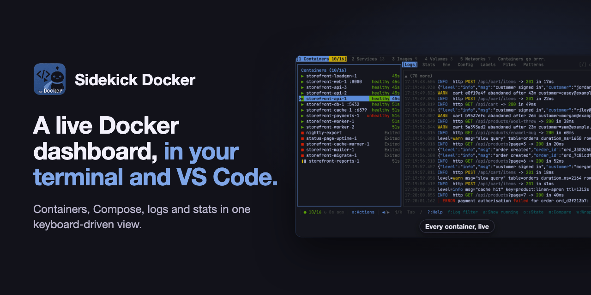
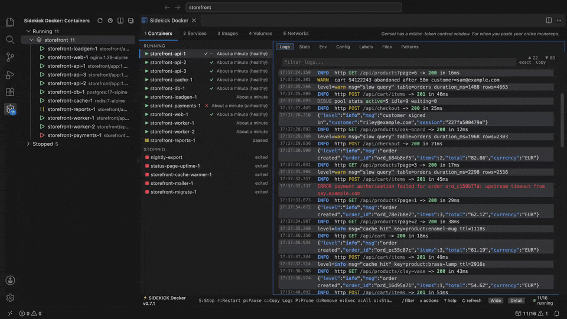

# Sidekick Docker



**A live Docker dashboard for your terminal and VS Code.**

Sidekick Docker puts containers, Compose services, logs, stats, images, volumes and networks in one keyboard-driven view that stays current from Docker's event stream, so you stop juggling `docker ps`, `docker logs -f`, `docker stats` and `docker compose ps`.

- **Logs you can read** — token highlighting, a filter that narrows as you type, severity counts, repeated lines grouped into patterns, and two log streams side by side.
- **See why something broke** — the failing health probe's output, exit codes, OOM kills and restart counts, without reaching for `docker inspect`.
- **Compose-aware** — projects with their replicas, services from the compose file that have not been created yet, and Up, Restart and Down from the list.
- **Safe by default** — every confirmation names its target; a prune says what it will remove and reports what it reclaimed.
- **Wherever Docker runs** — a local socket, `tcp://`, or `DOCKER_HOST=ssh://`; in a terminal on a server, or in VS Code, Remote windows included.


<p align="center">
  <a href="https://open-vsx.org/extension/CesarAndresLopez/sidekick-docker-vscode"></a>
  <a href="https://www.npmjs.com/package/sidekick-docker"></a>
  <a href="https://github.com/cesarandreslopez/sidekick-docker/blob/main/LICENSE"></a>
  <a href="https://github.com/cesarandreslopez/sidekick-docker/actions/workflows/ci.yml"></a>
  <a href="https://deepwiki.com/cesarandreslopez/sidekick-docker"></a>
</p>

## Quick Install

### Terminal (TUI)

```bash
npm install -g sidekick-docker
sidekick-docker
```

Needs Node.js 22.12 or later and the `docker` CLI on your `PATH`.

### VS Code and compatible editors

- **VSCodium and other Open VSX editors** — search for **Sidekick Docker** in the Extensions view, or run `codium --install-extension CesarAndresLopez.sidekick-docker-vscode`.
- **VS Code** — download `sidekick-docker-vscode-<version>.vsix` from the [latest GitHub Release](https://github.com/cesarandreslopez/sidekick-docker/releases/latest) and run `code --install-extension sidekick-docker-vscode-<version>.vsix`. The VS Code Marketplace listing is stuck at 0.4.1.

Then run `Sidekick Docker: Open Dashboard` from the command palette (or press `Ctrl+Alt+D`). See [Installation](getting-started/installation.md) for details.

## Feature Highlights

### Dashboard

- **Five panels** — Containers, Compose Services, Images, Volumes, Networks, switched with `1`-`5`
- **Live updates** — Docker events keep every list current; logs, stats sparklines and events stream in real time; `Ctrl+R` refreshes at once
- **Vi keybindings** — `j`/`k` navigation, `g`/`G` jump, `h`/`l` focus, `[`/`]` detail tabs, `PgUp`/`PgDn` and `Ctrl+D`/`Ctrl+U` paging
- **Layouts** — `z` cycles Normal, Wide (room for longer names) and Expanded (details only); `w` wraps long lines instead of cutting them off
- **Filter** — `/` narrows any resource list as you type
- **Mouse** — click to select, scroll to navigate, right-click for the actions menu; `M` turns mouse capture off so the terminal can select text

### Logs

- **Highlighting** — token-level colouring for HTTP methods, status codes, URLs, IPs, timestamps, JSON keys and more
- **Log filter** — `f` searches the log output with exact or fuzzy matching and highlights the matches
- **Log analytics** — severity counts, a severity sparkline over time, and pattern clustering that groups similar lines into templates
- **Compare** — `m` pins a container or Compose service; its logs then run beside those of the next item you select

### Containers

- **Full lifecycle** — start, stop, restart, pause, unpause, remove, exec, copy logs, and open a published port in the browser
- **Health tracking** — healthy/unhealthy/starting badges for containers with a health check
- **Config tab** — health check failures with the last probe's output, exit code and OOM kills, restart policy and count, mounts
- **Labels tab** — every label on the container, sorted by key
- **Files tab** — filesystem changes inside the container (added/changed/deleted)
- **Stats** — CPU, memory, network I/O and block I/O sparklines, plus the process count
- **Sorting** — by state, name, CPU, memory, network I/O, block I/O or PIDs; `R` reverses
- **Running-only toggle** — `a` hides containers without a live process
- **Interactive exec** — `e` opens a shell in a running container; npm installs hand the terminal to `docker exec -it`, source builds with `node-pty` embed it in the dashboard

### Compose, images, volumes and networks

- **Compose** — projects detected from container labels and the compose file; Up and Down per project, Restart and Stop per project or service
- **Image layer explorer** — layer history with sizes, Dockerfile instructions and layer comments
- **Prune per panel** — `P` removes stopped containers, dangling images, unused anonymous volumes (Engine 23+ keeps named ones) or unused networks; the confirmation names the count, and the result reports the space reclaimed (a count, for networks)

### Scriptable CLI

- **Commands** — `ps`, `logs`, `images`, `volumes`, `networks`, `stats`, `df` and `inspect`, each with `--format json` and `-q` where it makes sense, for scripts and pipes, with `--no-color`/`NO_COLOR` support
- **Disk usage** — `df` reports images, containers, volumes and build cache, the last of which is usually the biggest surprise
- **Endpoints** — `--socket` accepts a socket path, a `unix://` URL, or `tcp://host:port` for remote daemons; `ssh://` works through `DOCKER_HOST`

### VS Code

- **The same dashboard** as a webview panel, in VS Code, VSCodium and other compatible editors
- **Containers tree** in the activity bar, grouped by state and Compose project, with per-container actions, Exec, Show Logs and Compose Up/Restart/Down
- **Status bar** — running/total counts and unhealthy containers; click it to open the dashboard
- **Compose output** streams into the **Sidekick Docker** output channel



## See Also

**[Sidekick Agent Hub](https://github.com/cesarandreslopez/sidekick-agent-hub)** — Multi-provider AI coding agent monitor. Real-time visibility into Claude Code, OpenCode, and Codex CLI sessions with token tracking, context management, and session intelligence. Available as a [TUI on npm](https://www.npmjs.com/package/sidekick-agent-hub) and as a VS Code extension on the [Marketplace](https://marketplace.visualstudio.com/items?itemName=CesarAndresLopez.sidekick-for-max) and [Open VSX](https://open-vsx.org/extension/cesarandreslopez/sidekick-for-max).

## Next Steps

- [Installation](getting-started/installation.md) — all install methods
- [Quick Start](getting-started/quick-start.md) — first-run walkthrough
- [Keybindings](features/keybindings.md) — full keyboard reference
- [VS Code Extension](features/vscode.md) — tree view, settings, Remote windows
- [Architecture](architecture/overview.md) — how it all fits together
