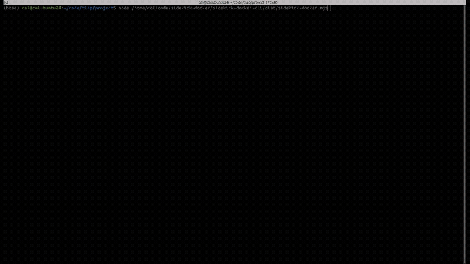

# Sidekick Docker CLI

[](https://www.npmjs.com/package/sidekick-docker)
[](https://www.npmjs.com/package/sidekick-docker)
[](https://github.com/cesarandreslopez/sidekick-docker/blob/main/LICENSE)
[](https://deepwiki.com/cesarandreslopez/sidekick-docker)

A terminal dashboard for Docker. Manage containers, Compose projects, images, volumes, and networks — all from a single, keyboard-driven TUI. Includes scriptable `ps`, `logs`, `images`, `volumes`, `networks`, `stats`, `df` and `inspect` commands for non-interactive use.

<p align="center">
  
</p>

## Install

```bash
npm install -g sidekick-docker
```

**Prerequisites:** Node.js >= 22.12, Docker running.

## Usage

```bash
# Launch the interactive dashboard
sidekick-docker

# List containers (non-interactive)
sidekick-docker ps
sidekick-docker ps --all
sidekick-docker ps --format json | jq   # machine-readable output
sidekick-docker ps -q                   # container IDs only

# Stream container logs
sidekick-docker logs <container>
sidekick-docker logs <container> --no-follow --tail 50

# Inventory (all support --format json; images, volumes, networks and stats also support -q)
sidekick-docker images
sidekick-docker volumes
sidekick-docker networks

# One-shot resource usage, like `docker stats --no-stream`
sidekick-docker stats

# Disk usage, including build cache — like `docker system df`
sidekick-docker df

# Raw inspect payload for a container (name, full ID, or ID prefix)
sidekick-docker inspect <container> | jq .State.Health
```

### Options

| Flag | Description |
|------|-------------|
| `--socket <endpoint>` | Docker endpoint: socket path, `unix://` or `tcp://host[:port]` URL |
| `--no-color` | Disable colored output, including the dashboard (also honors `NO_COLOR` / `FORCE_COLOR`) |
| `--verbose` | Show full error details |
| `--shell <path>` | Shell for Exec in the dashboard (default: `$SIDEKICK_DOCKER_SHELL`, else `/bin/sh`) |
| `--no-mouse` | Start the dashboard with mouse capture off, so the terminal can select text (`M` toggles it) |
| `--version` | Show version |
| `--help` | Show help |

## Dashboard

The dashboard has 5 panels, each mapped to a number key:

| # | Panel | Rows show | Detail Tabs |
|---|-------|-----------|-------------|
| 1 | **Containers** | State, name, first published port, health, uptime | Logs, Stats, Env, Config, Labels, Files, Patterns |
| 2 | **Services** | Compose projects and their services, with running/total counts | Info, Logs |
| 3 | **Images** | Tag, size | Info, Layers |
| 4 | **Volumes** | Name, driver, in-use status | Info |
| 5 | **Networks** | Name, attached-container count | Info |

The container **Config** tab adds what only `docker inspect` knows: the health check's failing streak and last probe output, the exit code with OOM kills and daemon errors, the restart policy and restart count, and mounts.

Services show running/total replica counts. Lifecycle actions use the project's recorded Compose files in override order and report missing files before running.

Partial refresh failures retain the last successful resource data and identify the affected resources in the status bar. Press `Ctrl+R` to try again — the status bar also suggests it once the last refresh is a minute old.

Exec runs `/bin/sh` unless you pick another shell with `--shell` or `SIDEKICK_DOCKER_SHELL`; if the shell is missing from the image (distroless, scratch), a toast says so. The npm package does not ship the optional `node-pty` module, so Exec normally hands the terminal to `docker exec -it`: exit the shell with `exit` or `Ctrl+D` to return to the same dashboard selection and view. When `node-pty` can be loaded (e.g. a source checkout), the shell runs embedded and `Ctrl+]` detaches from it.

## Keybindings

### Navigation

| Key | Action |
|-----|--------|
| `j` / `Down` | Move down |
| `k` / `Up` | Move up |
| `g` | Jump to top |
| `G` | Jump to bottom. While log follow is paused, `G` resumes it first, wherever focus is |
| `PgUp` / `PgDn` | Page up / down |
| `Ctrl+U` / `Ctrl+D` | Half page up / down |
| `Tab` | Toggle focus between side list and detail pane |
| `Enter` / `l` / `Right` | Focus detail pane |
| `Esc` | Back to side list / close overlay / clear filter |
| `h` / `Left` | Back to side list (when in detail pane) |

### Panels & Tabs

| Key | Action |
|-----|--------|
| `1`-`5` | Switch to panel |
| `[` / `]` | Cycle detail tab left / right |

### Global

| Key | Action |
|-----|--------|
| `x` | Open the actions menu for the selected item |
| `f` | Open log filter (when on Logs tab) |
| `/` | Open filter |
| `a` | Toggle all/running containers (Containers panel) |
| `o` | Open sort menu (Containers panel) |
| `R` | Reverse sort direction (Containers panel) |
| `m` | Pin/unpin item for log comparison (Containers/Services) |
| `J` / `K` | Scroll the pinned comparison pane (while comparing) |
| `z` | Cycle layout (Normal → Wide → Expanded) |
| `M` | Toggle mouse capture (off lets the terminal select and copy text) |
| `Ctrl+R` | Refresh now |
| `?` | Show help overlay (scroll with `j`/`k`, `PgUp`/`PgDn`, `g`/`G`) |
| `V` | Show version |
| `q` / `Ctrl+C` | Quit |

Item actions below work directly on the selected item or from the `x` menu; only those that apply to its current state are offered.

### Container Actions

| Key | Action |
|-----|--------|
| `s` | Start (exited or created) |
| `S` | Stop (running, paused or restarting) |
| `r` | Restart |
| `p` / `u` | Pause / Unpause |
| `d` | Remove (with confirmation; a running container is force-stopped first) |
| `e` | Exec into container |
| `b` | Open a published port in the browser |
| `P` | Prune — remove all stopped containers (confirmation names the count), reporting space reclaimed |
| `c` | Copy logs to clipboard (respects the log filter) |

### Image, Volume and Network Actions

| Key | Action |
|-----|--------|
| `d` | Remove (with confirmation; volumes only when unused, networks only when custom and empty) |
| `P` | Prune dangling images / unused anonymous volumes (Engine 23+ keeps named ones) / unused networks (confirmation names the count) |

### Compose Actions

| Key | Action |
|-----|--------|
| `u` | Up (start project) |
| `D` | Down — `docker compose down`: removes containers and networks, keeps volumes (with confirmation) |
| `r` | Restart |
| `S` | Stop |
| `c` | Copy logs to clipboard |

### Mouse

Click to select items, switch panels/tabs, and press overlay buttons; right-click
opens the actions menu; the wheel moves the list selection or scrolls the details
(scrolling up in logs pauses follow — jump to the bottom or press `G` to resume).
Press `M` to turn mouse capture off so the terminal can select and copy text
(`--no-mouse` starts that way).

## Features

- **Real-time log streaming** — follows container logs with token-level syntax highlighting (HTTP methods, status codes, URLs, IPs, timestamps, JSON keys)
- **Dual-log compare** — pin a second container or service with `m` to view both log streams side by side
- **Log search & filter** — press `f` on the Logs tab to search within log output with exact or fuzzy matching and match highlighting
- **Log analytics** — severity count badges, severity sparkline over time, and pattern clustering that groups similar logs into templates with `<*>` wildcards
- **Live stats with sparklines** — CPU, memory, network I/O, block I/O, and log severity charted as inline sparklines (60-sample history)
- **Filesystem inspector** — view all filesystem changes inside containers (added/changed/deleted files)
- **Image layer explorer** — inspect image layer history with sizes and Dockerfile instructions
- **Interactive exec** — open a shell inside any running container (`--shell` to choose it)
- **Open in browser** — `b` opens a running container's published port (`xdg-open` / `open` / `rundll32`, never via a shell; the daemon's host for `tcp://` and `ssh://` endpoints)
- **Container details** — health check failures, exit code and OOM kills, restart policy, mounts in the Config tab
- **Compose detection** — automatically discovers projects from container labels, merges with compose file config
- **Filter** — press `/` to filter any list by name
- **Confirmation modals** — destructive actions always ask before executing
- **Mouse support** — click items to select, scroll to navigate; `M` releases the mouse for text selection
- **Toast notifications** — non-blocking feedback for actions; errors wrap to three lines and stay up longer
- **Readable on any terminal** — accent colour tuned for dark and light backgrounds; `NO_COLOR` or `--no-color` makes the whole dashboard monochrome

## Configuration

### Custom Docker Endpoint

`--socket` accepts a socket path, a `unix://` URL, or a `tcp://host[:port]` URL (port defaults to 2375; TLS is used for `https://` URLs or `tcp://` on port 2376, while an explicit `http://` stays plain HTTP):

```bash
sidekick-docker --socket /var/run/docker.sock
sidekick-docker --socket unix:///run/user/1000/docker.sock
sidekick-docker --socket tcp://192.168.1.100:2375
```

When `--socket` is not given, the standard `DOCKER_HOST` environment variable is honored (including `ssh://` endpoints), along with `DOCKER_TLS_VERIFY` and `DOCKER_CERT_PATH`:

```bash
DOCKER_HOST=tcp://192.168.1.100:2375 sidekick-docker ps
DOCKER_HOST=ssh://user@remote-host sidekick-docker
```

### Exec Shell

```bash
sidekick-docker --shell /bin/bash
SIDEKICK_DOCKER_SHELL=/bin/ash sidekick-docker
```

## Documentation

Full documentation is available at the [docs site](https://cesarandreslopez.github.io/sidekick-docker/).

## See Also

**[Sidekick Agent Hub](https://github.com/cesarandreslopez/sidekick-agent-hub)** — Multi-provider AI coding agent monitor. Real-time visibility into Claude Code, OpenCode, and Codex CLI sessions with token tracking, context management, and session intelligence. Available as a [TUI on npm](https://www.npmjs.com/package/sidekick-agent-hub) and a [VS Code extension](https://marketplace.visualstudio.com/items?itemName=CesarAndresLopez.sidekick-for-max).

## Contributing

Contributions are welcome! See [CONTRIBUTING.md](../CONTRIBUTING.md) for setup instructions and guidelines.

## License

[MIT](../LICENSE)
