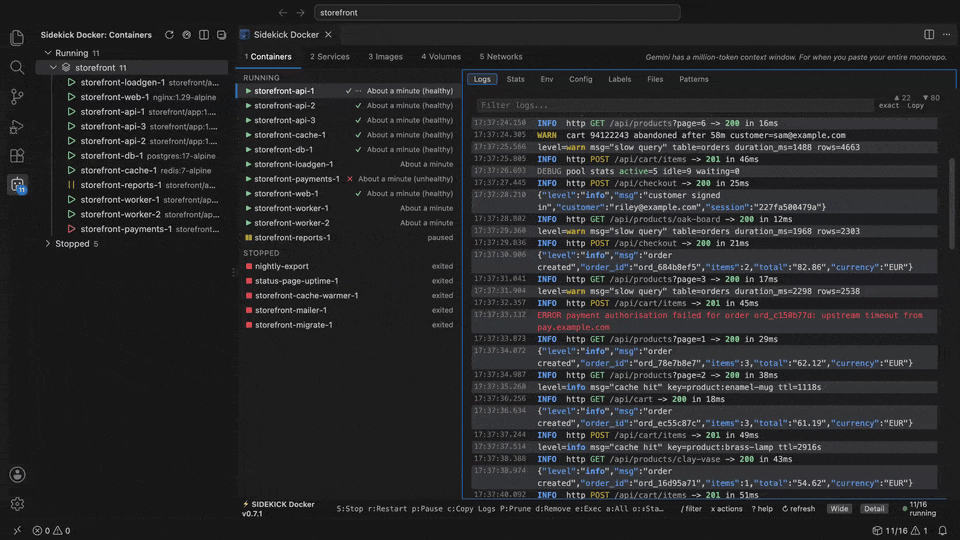
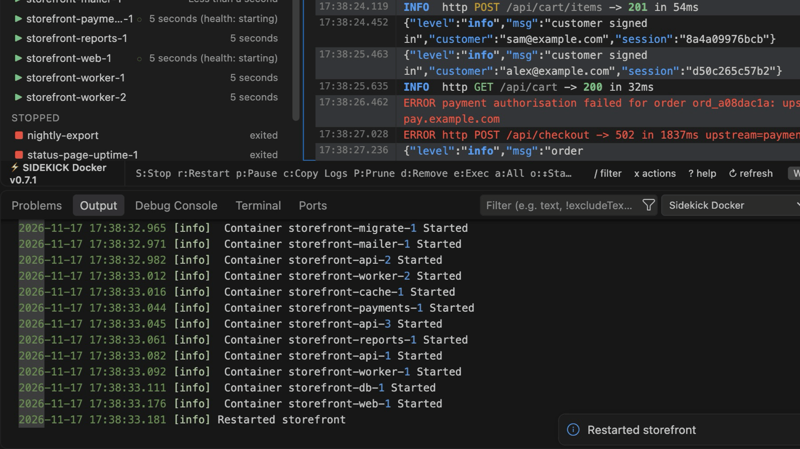

# Sidekick Docker for VS Code

[](https://open-vsx.org/extension/CesarAndresLopez/sidekick-docker-vscode)
[](https://open-vsx.org/extension/CesarAndresLopez/sidekick-docker-vscode)
[](https://github.com/cesarandreslopez/sidekick-docker/blob/main/LICENSE)

**A live Docker dashboard inside your editor.** Containers, Compose services, logs, stats, images, volumes and networks in one keyboard-driven panel that stays current from Docker's event stream, plus a Containers tree with Compose up, restart and down. It works in VS Code, VSCodium and other compatible editors (VS Code 1.109 or later), including Remote-SSH, WSL and Dev Container windows.



- **Logs you can read**: highlighting, a filter that works as you type, severity counts, repeated lines grouped into patterns, and two streams side by side.
- **Why it broke**: a failing health check's last output, exit codes, OOM kills and restart counts, without `docker inspect`.
- **Compose from the tree**: Compose Up, Restart and Down on project groups, with the output streamed into an output channel.
- **Safe by default**: removes and prunes ask first and name their target; a prune reports what it reclaimed.

The same dashboard also runs in a terminal: `npm install -g sidekick-docker` ([npm](https://www.npmjs.com/package/sidekick-docker)).

## Install

- **VSCodium and other Open VSX editors**: search for **Sidekick Docker** in the Extensions view, or install it from [Open VSX](https://open-vsx.org/extension/CesarAndresLopez/sidekick-docker-vscode).
- **VS Code**: download `sidekick-docker-vscode-<version>.vsix` from the [latest GitHub release](https://github.com/cesarandreslopez/sidekick-docker/releases/latest), then run `code --install-extension sidekick-docker-vscode-<version>.vsix`, or use **Extensions: Install from VSIX…** from the `…` menu of the Extensions view.

You need Docker running and the `docker` CLI on your `PATH` (Compose actions, Exec and Show Logs run it).

## Usage

Run **Sidekick Docker: Open Dashboard** from the command palette, press `Ctrl+Alt+D` (`Ctrl`, not `Cmd`, on macOS too; not while the terminal has focus), or open the Sidekick Docker icon in the activity bar. The dashboard opens as an editor panel with the terminal dashboard's layout, panels and keys, and survives window reloads. A few keys differ: `F5` refreshes, `e` opens a VS Code terminal, `w` toggles log wrapping (on by default), and in compare mode `m` re-pins rather than ends. See [Dashboard keys](https://cesarandreslopez.github.io/sidekick-docker/features/vscode/#dashboard-keys).



The activity-bar **Containers** tree groups containers into Running and Stopped, with Compose projects as sub-groups. Its context menu offers start, stop, restart, pause, unpause and remove, Exec, Show Logs and **Open in Dashboard**, only where they apply to the container's state. While connecting it says **Connecting to Docker…**; when Docker is offline it says why (permission denied, missing socket, connection refused…) and links to the setting. The status-bar item shows a spinner while connecting, then running/total and unhealthy counts, and its tooltip names the endpoint or the offline reason.

Compose Up, Restart and Down stream their output into the **Sidekick Docker** output channel and can be cancelled from their progress notification (Stop cannot); failures offer **Show Output**. When Docker comes back, the dashboard reconnects by itself.

### Commands

| Command | Description |
|---------|-------------|
| `Sidekick Docker: Open Dashboard` | Open the dashboard (`Ctrl+Alt+D`, all platforms, not while the terminal has focus) |
| `Sidekick Docker: Open Dashboard to the Side` | Open in a split editor column |
| `Sidekick Docker: Refresh Containers` | Refresh the tree view (`Ctrl+Alt+R` / `Cmd+Alt+R` when it has focus) |
| `Sidekick Docker: Start/Stop/Restart Container...` | Quick-pick a container to act on |
| `Sidekick Docker: Exec into Container...` | Quick-pick a running container and open a terminal in it (`exec.defaultShell`) |
| `Sidekick Docker: Show Container Logs...` | Quick-pick a container and open a terminal running `docker logs -f --tail 200` |
| `Open in Dashboard` *(tree only)* | Open the dashboard on a container |
| `Compose Up` / `Compose Restart` / `Compose Down` *(tree only)* | Run on a Compose project group. Restart and Down appear whenever any of the project's containers is live; Down asks first; all three are hidden in untrusted workspaces |

`F5` refreshes the dashboard while it has focus.

### Settings

| Setting | Default | Description |
|---------|---------|-------------|
| `sidekick-docker.socketPath` | `""` | Docker endpoint: socket path, `unix://`, or `tcp://host[:port]`. Empty uses `DOCKER_HOST`, else the platform default. `ssh://` works only through `DOCKER_HOST`. |
| `sidekick-docker.refreshIntervalSeconds` | `30` | Fallback full-refresh interval (min 5). |
| `sidekick-docker.statusBar.visible` | `true` | Show the status-bar container counts. |
| `sidekick-docker.exec.defaultShell` | `/bin/sh` | Shell used by "Exec into container". |

Sidekick Docker does not read `docker context`: with Colima, OrbStack or rootless Docker, set `socketPath` (or `DOCKER_HOST`).

In an untrusted workspace, `socketPath` and `exec.defaultShell` are read from user settings only (they are restricted settings), and Compose is disabled. Trusting the folder applies the workspace values and reconnects. Both settings are also *machine-overridable*: in a Remote-SSH, WSL or Dev Container window they come from that remote's settings, not your local user settings.

## Features

- **Five panels**: containers, Compose services, images, volumes and networks, with a detail pane per item (Logs, Stats, Env, Config, Labels, Files and Patterns for containers; Layers for images)
- **Live logs**: token-level highlighting for HTTP methods, status codes, URLs, IPs, timestamps and JSON keys; a sticky filter with exact or fuzzy matching; severity count badges
- **Patterns**: similar log lines grouped into templates with `<*>` wildcards and counts
- **Compare**: pin a container or service with `m` and read two log streams side by side
- **Live stats**: CPU and memory bars, network and block I/O sparklines, and a Log Activity chart of severities over time
- **Config tab**: the health check's failing streak and last probe output, exit code with OOM kill or daemon error, restart policy and count, mounts
- **Files and Layers**: a container's filesystem changes (added, changed, deleted) and an image's layer history with sizes and Dockerfile instructions
- **Actions**: start, stop, restart, pause, unpause and remove from the dashboard or the tree; prune per panel, with the count in the confirmation and the space reclaimed afterwards
- **Open in Browser**: `b` on a running container with a published port (a quick pick when there are several; works through remote port forwarding)
- **Filter, sort and layout**: `/` filters any list, `o` sorts containers (State, Name, CPU %, Memory %, Network I/O, Block I/O, PIDs), `z` cycles Normal, Wide and Expanded, `?` shows every key
- **Compose-aware**: projects from container labels plus the workspace's compose file (so services not yet created show up), the recorded override files kept for lifecycle actions, running/total replicas for scaled services
- **Connection awareness**: a disconnected banner and toast that give the real reason with one-click Retry, a Retry Connection action in the Containers view, and automatic reconnects
- **Mouse-friendly and accessible**: click rows and tabs, right-click a row for its action menu; ARIA roles, labels and live regions, roving tabindex across tabs, focus kept inside dialogs, high-contrast focus outlines
- **SSH**: the packaged extension includes the SSH transport for `DOCKER_HOST=ssh://user@host`

## Requirements

- **VS Code** >= 1.109 (or a compatible editor)
- **Docker** running, and the `docker` CLI on your `PATH`

## Build from Source

Build the shared package first (the extension depends on it by path), then package:

```bash
git clone https://github.com/cesarandreslopez/sidekick-docker.git
cd sidekick-docker
bash scripts/build-all.sh          # installs and builds shared → cli → vscode
cd sidekick-docker-vscode
npx @vscode/vsce package
code --install-extension sidekick-docker-vscode-*.vsix
```

To debug, open the `sidekick-docker-vscode` folder in VS Code, press `F5` and pick **VS Code Extension Development** in the debugger picker (no `launch.json` is committed).

## Architecture

The dashboard is a webview panel. The extension host (Node.js) and the webview (browser) talk through `postMessage()` with a typed, validated message protocol:

- **Extension** (`src/extension.ts`): activates on startup (`onStartupFinished`), registers commands, and populates the Containers tree and status bar
- **Provider** (`src/providers/DockerDashboardProvider.ts`): manages the webview lifecycle and the Docker calls through `sidekick-docker-shared`
- **Webview** (`out/webview/dashboard.js`): renders the dashboard and sends user actions back to the extension
- **Messages** (`src/types/messages.ts`): the typed messages in both directions

## Documentation

Full documentation is available at the [docs site](https://cesarandreslopez.github.io/sidekick-docker/), including the [VS Code page](https://cesarandreslopez.github.io/sidekick-docker/features/vscode/).

## See Also

**[Sidekick Agent Hub](https://github.com/cesarandreslopez/sidekick-agent-hub)**: see what your AI coding agents are doing, and what they cost. Live monitoring for Claude Code, Codex and OpenCode, as a [terminal dashboard on npm](https://www.npmjs.com/package/sidekick-agent-hub) and a [VS Code extension](https://marketplace.visualstudio.com/items?itemName=CesarAndresLopez.sidekick-for-max).

## Contributing

Contributions are welcome! See [CONTRIBUTING.md](https://github.com/cesarandreslopez/sidekick-docker/blob/main/CONTRIBUTING.md) for setup instructions and guidelines.

## License

[MIT](LICENSE)
